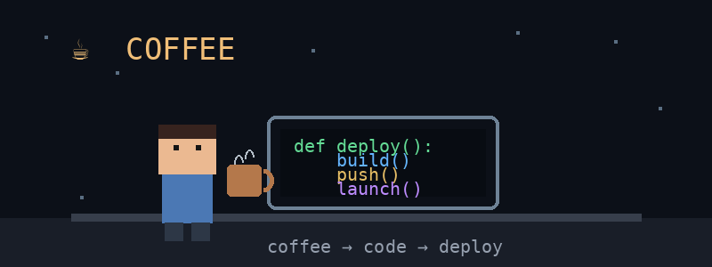
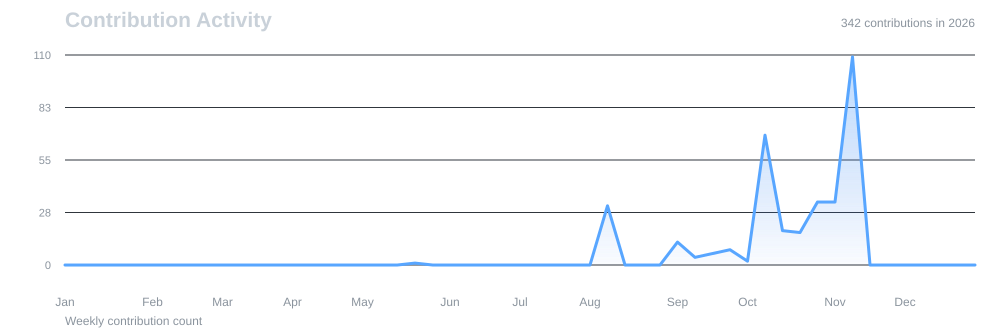

<h1 align = "center">Hi i am Priyansh👋</h1>

 Student • Web Designer • Tech Enthusiast

<!-- 

  

 -->

 

## 🪶 About Me

- 💻 Computer Science student building modern, responsive and scalable web applications
- ⚛️ Experienced with technologies including React, Next.js, Node.js, JavaScript, Supabase and Firebase
- 🗄️ Working with databases such as PostgreSQL and building complete frontend-to-backend applications
- 🎨 Interested in UI/UX and designing modern interfaces using Figma and Framer
- 🤖 Exploring automation and workflow development with n8n
- 📊 Skilled in data visualization and productivity tools including Power BI, Excel and PowerPoint
- 🧠 Continuously learning new technologies and expanding my skills across web development and software development
- 🚀 Building projects, experimenting with ideas and turning them into functional applications

 

<!--
**priyanshjain08/priyanshjain08** is a ✨ _special_ ✨ repository because its `README.md` (this file) appears on your GitHub profile.

Here are some ideas to get you started:

- 🔭 I’m currently working on ...
- 🌱 I’m currently learning ...
- 👯 I’m looking to collaborate on ...
- 🤔 I’m looking for help with ...
- 💬 Ask me about ...
- 📫 How to reach me: ...
- 😄 Pronouns: ...
- ⚡ Fun fact: ...
-->

## 🌐 Socials:

 

## 💻 Tech Stack

### 🎨 Frontend

 

<!--

-->

### ⚙️ Backend, Database & Cloud

<!---->

### 💻 Programming Languages

### 🛠️ Editor & Design

### 🧰 Tools & Version Control

### ☁️ Deployment & Hosting

### ⚡ Automation

### 🤖 AI Development Tools

### 📊 Data & Productivity

 

## 📂 Featured Projects

<!--### Personal Portfolio

A responsive personal portfolio website of **Priyansh Jain**, presented as a web designer and digital creative. The site highlights an introduction, design and development skills, selected frontend projects, and contact option.-->

### Reforge

A self-healing platform that monitors services, detects failures, diagnoses the likely cause, and applies policy-approved fixes like restarting a crashed container, then verifies the service is healthy again. Every action is audited and can be stopped with a kill switch, and it comes with a React dashboard and a chaos lab for safely breaking demo services.

### StudySphere

A native, offline-first Android app for students, built with Kotlin and Jetpack Compose. It brings a study planner, assignments, Pomodoro focus timer, notes, spaced-repetition flashcards, exam tracker, analytics and reminders into one app

### SyncSpace

SyncSpace is a real-time collaborative workspace for teams: create workspaces,
manage projects and tasks on a Kanban board, chat with your team, and see
everything update live for everyone else looking at it — no page refresh.

### DevDesk - Project & Issue Management Platform

DevDesk is a comprehensive project and issue management platform designed for software developers, teams, and small organizations.

<b> More projects coming soon... </b>

 

## 📈 Contribution Activity

  

 

<!--## 📊 GitHub Stats:
 
 

---

<!-- Proudly created with GPRM ( https://gprm.itsvg.in ) -->
